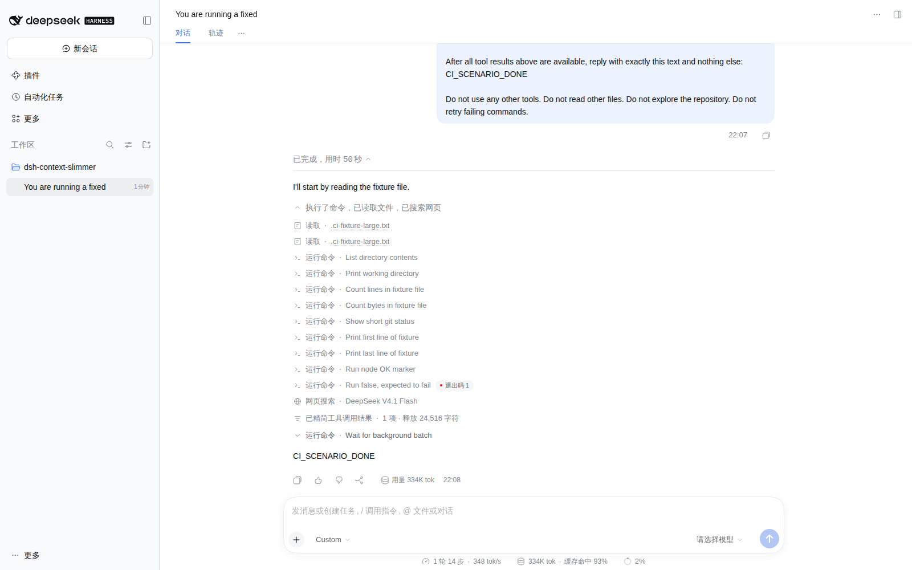

# Context Slimmer（上下文精简器）

面向 [DeepSeek Harness](https://github.com/deepseek-ai/dsh) 的原生插件 bundle：在不改写用户已经看到的对话记录的前提下，让 Agent 的上下文保持精简。插件由多个**完全独立**的功能模块组成——每个模块是独立的 npm 包、独立的 Loader row，因此原生插件面板可以单独开关、单独配置每个模块，一个模块的开关不影响其他模块。

第一个模块是 **工具结果精简**：每累计 N 次工具调用**且**新增输出达到字符阈值时，一个隐藏的规划模型（直接 `ctx.llm.stream()` 单次调用，拿到会话完整上下文，**不创建子 Agent**）判断哪些过期工具结果属于“可证明的冗余”，只删这些。主 Agent 的下一次请求只看到精简后的结果；对话记录中的原始工具卡片保持不变；并像原生“上下文已压缩”一样，在对话流追加一行“已精简工具调用结果”。

```
精简前                              精简后
┌──────────────────────────┐        ┌──────────────────────────┐
│ tool read  12.4k 字符    │        │ tool read  [elided …]    │  ← 模型可见 surface
│ tool grep   8.1k 字符    │  ───►  │ tool grep  [elided …]    │     （replace 事件）
│ tool test   失败输出 …   │        │ tool test   失败输出 …   │  ← 精确证据保留
└──────────────────────────┘        └──────────────────────────┘
   对话记录保持不变                    + “已精简工具调用结果 · 2 项 · 20,500 字符”
```

## 为什么

2026 年关于 Agent 上下文的研究结论很一致：Agent 的大部分 token 都是工具观察结果，而**互相竞争的过期观察**比“更长但中性的上下文”更伤准确率。但粗暴压缩同样危险——它会删掉约束与失败证据、改写用户已看到的记录，还会诱发昂贵的重读。本插件的处理原则：

1. **用完整上下文判断，而不是给一段摘要。** 规划器收到会话的派生消息，因此“这条结果现在还有用吗”由真正看过任务的模型回答。
2. **绝不改写用户可见历史。** 替换是模型可见的 surface 事件（`surfaceOp: replace`），与官方工具结果 pruner 完全一致；append-origin 事件保留原始卡片，fork/resume 回放安全。
3. **默认保守。** 默认 `conservative` 策略只做“宿主可重新验证证据”的整条 drop：重复读取、被后续成功重试覆盖的失败结果、空输出。唯一长文本读取与失败证据默认不动，trim（改写内容）直接拒绝；`balanced`/`aggressive` 需显式开启。
4. **便宜且隐身。** 一次直调模型，而不是 fork 子 Agent：没有子会话、没有 `subagent/*` 事件、不计入 WebUI“N 个子智能体”、主 Agent 的 subagent 工具也列不出它。

背后的文献综述、DSH 协议图、精简策略与 benchmark 设计都在 [`docs/`](docs/)。

## 模块

| 模块 | 包 | Row id | 状态 |
|---|---|---|---|
| 工具结果精简 | `@ds-hu/dsh-context-slimmer-tool-result` | `context-slimmer-tool-result` | `0.2.x` 已发布 |
| 未来模块 | 各自 `packages/*` | 各自 row | 规划中——每个模块保持独立开关 |

共享纯库 `@ds-hu/dsh-context-slimmer-core` 刻意**不是** Loader row：面板无法开关它，任何模块也不会误卸载它。

## 安装

```bash
dsh plugin --profile <profile> add @ds-hu/dsh-context-slimmer
```

bundle patch 会为每个模块插入一行；每一行从 profile 解析自己的包。重启 profile（或等待 patch 热重载）后打开 **插件** 面板：bundle 与模块行会带原生开关出现。**点击模块标题**即可打开配置页。

**不要**把这些 row 复制进你自己的 `cordis.patch.yml`：重复的 `id` 会让 profile 启动失败（`entry <id> already exists`）。请在面板里配置该 row。

## 配置（工具结果精简）

以下字段都可在原生插件面板（点击模块标题）修改并实时生效；保存会写入 profile 的 `cordis.patch.yml`。

| 配置 | 默认 | 含义 |
|---|---|---|
| `enabled` | `true` | 模块总开关。 |
| `everyNToolCalls` | `12` | 新增工具结果数 ≥ N 才触发（`0` = 不按数量判断）。 |
| `minChars` | `24000` | 新增工具结果字符数 ≥ 阈值才触发（`0` = 不按字符判断）。两项是 **AND**。 |
| `protectRecent` | `3` | 最近 K 条工具结果永不触碰。 |
| `maxTargets` | `4` | 单次最多审查的候选数（1–20）。 |
| `minTargetChars` | `4096` | 小于该长度的结果不候选。 |
| `triggerOnErrorOnly` | `false` | 仅当窗口内出现失败结果才触发。 |
| `timeoutMs` | `120000` | 规划器硬超时；超时 = no-op。 |
| `policy` | `conservative` | `conservative`（默认）/ `balanced` / `aggressive`。 |
| `includeSubagents` | `true` | 也精简子 Agent 会话（含 agent-team 成员）。 |
| `model.provider` / `model.model` | 空 = inherit | 跟随当前 Agent 路由；或固定一条路由。 |
| `model.reasoningEffort` | `inherit` | `inherit` 复制当前路由的推理档（保留思考）；或 off/low/medium/high/max。 |
| `model.maxOutputTokens` | `0` | `0` = 跟随模型默认（不设上限）。正数会限制**整个 completion（含推理 token）**——设得太小会截断规划器（v0.1.0 的真实回归，0.2.0 已修复）。 |

不在面板页里的高级字段（`promptLocale`、`diagnosticsFile`）可在 profile `cordis.patch.yml` 的该 row `config` 中设置。

## 工作原理（简版）

1. `agent/pre-step`——上一批工具已结算、下一次请求尚未组装时——按会话统计新增工具结果；根 Agent 与（默认）子 Agent 都处理。
2. 两个阈值同时满足时，宿主发**一次隐藏的规划器调用**（`ctx.llm.stream()`）：会话派生消息 + tool history + 紧凑候选列表。不启动 subagent、不给工具、不传 `purpose`。
3. 计划由纯宿主代码原子校验。`conservative` 下每条 `drop` 都必须带宿主可复算的证据（`duplicateOf` / `supersededBy` / `empty`）；`trim` 整单拒绝。
4. 通过的目标先 append `compaction/prune`，再 append surface 的 `tool/result` 替换事件。批次摘要通过 prune 的 additive `contextSlimmer` 字段驱动聊天行。
5. 任何失败——模型、超时、计划非法、策略拒绝、append 异常——对主 Agent 都是 no-op；显式 `maxOutputTokens` 导致截断时自动不带 cap 重试一次，仍失败才放弃。

完整协议、安全规则与兼容降级： [`docs/protocol.md`](docs/protocol.md)、[`docs/architecture.md`](docs/architecture.md)、[`docs/dev-notes.md`](docs/dev-notes.md)。

## 从 0.1.0 升级

- 默认策略改为 `conservative`：只删除可证明冗余的内容（重复读取、被后续成功重试覆盖的失败、空输出）。trim 需显式设 `policy: balanced`/`aggressive`。
- `model.maxOutputTokens` 默认 `0`（跟随模型默认）。若你在 0.1.0 里设过小上限（如 `2048`）请重置——该上限同时覆盖推理 token，曾导致规划器截断。
- `model.reasoningEffort` 默认 `inherit`（保留当前模型的思考强度），不再固定。
- `forkProvider` 配置键已移除：规划器改为直调 LLM。0.1.0 配置里残留该键仍可挂载（兼容接受并忽略，附弃用警告），建议从 profile patch 删除。
- 子 Agent 会话默认也会被精简（`includeSubagents: true`）；只想处理根 Agent 时设为 `false`。
- 运行 `dsh plugin --profile <profile> add @ds-hu/dsh-context-slimmer@0.2.0` 后重载 profile（或重启），确保 host 与 client 两半都更新。

## Benchmark

CI benchmark 在同一确定性场景上对比三种模式：baseline（插件 disabled）、`conservative`（默认）、`aggressive`，场景含 5 个精确事实校验点。硬门禁要求 `conservative` 保住全部 5 个事实、折叠后的工具文本明显少于 baseline、且规划器截断次数为 0。结果由 [`.github/workflows/benchmark.yml`](.github/workflows/benchmark.yml) 生成并发布到 [`docs/benchmark.md`](docs/benchmark.md)（单次结果仅作方向性证据，不宣称统计显著）。

## 兼容性与已知限制

- 需要 DSH `>=0.2.0 <0.3.0`、Node.js `>=24.9.0`。
- 聊天行依赖官方 log-only `compaction/prune` 事件上的 **additive JSON 字段**；宿主会检测更严格的未来校验并降级为官方三字段事件：替换照常落地，仅聊天行消失。
- 规划器是直调 LLM：不创建子 Agent 会话，因此 WebUI 的“N 个子智能体”计数与主 Agent 的 subagent 工具都看不到它；它能看到会话派生消息（但不暴露任何工具）。
- 显式 `model.maxOutputTokens` 是**包含推理 token 的总输出预算**；没有成本上限需求时保持 `0`。
- `includeSubagents: false` 会连同 agent-team 成员一起跳过（它们同样是 subagent-origin 会话）。
- 自定义面板 page 取代原生自动表单，因此 `promptLocale`/`diagnosticsFile` 不在页面里（值会保留，可在 `cordis.patch.yml` 修改）。
- 插件日志不记录工具原文或用户内容；诊断只含计数、模型标识、耗时与模型写的一行原因。
- client 半无网络请求，只消费事件 payload。

## 截图（来自 CI 中的真实 DSH 运行）

所有截图都来自 GitHub Actions 中启动的真实 DeepSeek Harness（真实模型会话 + `dsh web`）：

对话流中与原生风格一致的“已精简工具调用结果”行：



展开后的明细（条目 / 触发条件 / 模型）：


轨迹里模型实际看到的内容（`[elided by context-slimmer]`）：


从插件面板模块行打开的**原生配置页**：


原生插件面板中的模块（可独立开关/配置）：


## 开发

```bash
npm install          # workspaces：bundle + core + module
npm test             # 离线单测（不启动 dsh、不调 API）
npm run test:core
node --test packages/tool-result-slimmer/test/*.test.mjs
```

真实端到端验证（headless 会话 + 真实模型 + Web UI 截图）与 benchmark 在 GitHub Actions 运行；见
[`.github/workflows/verify.yml`](.github/workflows/verify.yml)、
[`.github/workflows/benchmark.yml`](.github/workflows/benchmark.yml) 与 [`docs/ci.md`](docs/ci.md)。

## License

MIT © ds-hu
